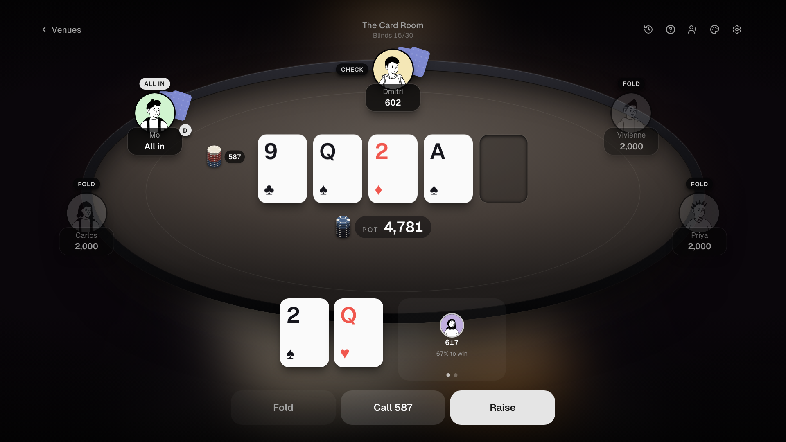
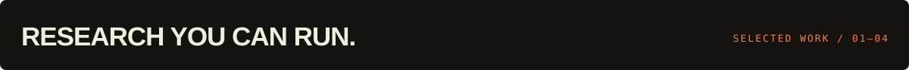
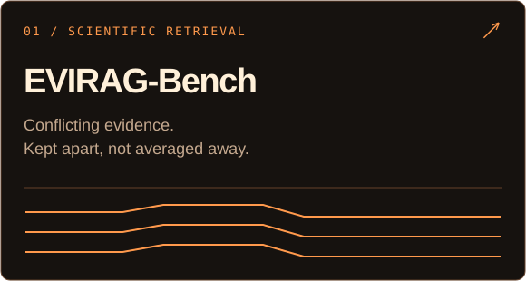
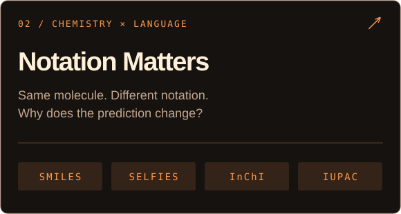
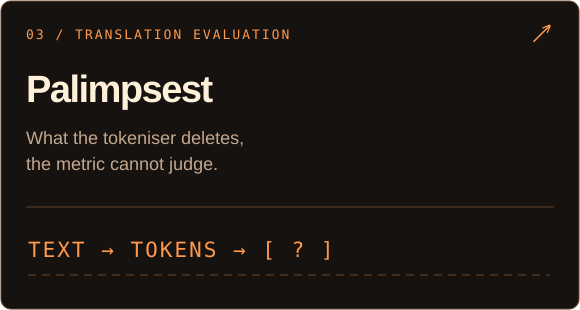
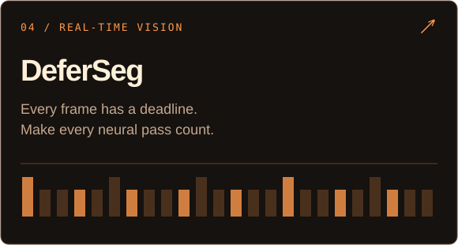

  

  <a href="https://www.animeshmishra.us/"><b>WEBSITE ↗</b></a> &nbsp;·&nbsp;
  <a href="https://www.animeshmishra.us/releases"><b>PUBLICATIONS ↗</b></a> &nbsp;·&nbsp;
  <a href="https://www.linkedin.com/in/animesh-mishra-in/"><b>LINKEDIN ↗</b></a> &nbsp;·&nbsp;
  <a href="mailto:animeshmishra0567@gmail.com"><b>LET’S TALK ↗</b></a>

ML / NLP RESEARCHER &nbsp;·&nbsp; NEW DELHI, INDIA &nbsp;·&nbsp; OPEN TO RESEARCH ROLES

<a href="https://amethystani.github.io/amethystani/"><b>PLAY THE TABLE ↗</b></a>

 

I study **when language models can be trusted**—especially when evidence conflicts, inputs change form, or evaluations miss something important. I build benchmarks and systems to test those limits.

Previously: **Nous Research** · **DRDO** · **Complexity Science Hub Vienna** &nbsp; / &nbsp; Co-founded **ClerkTree**

 

 
 
 

PYTHON &nbsp;·&nbsp; RUST &nbsp;·&nbsp; PYTORCH &nbsp;·&nbsp; NLP &nbsp;·&nbsp; RAG &nbsp;·&nbsp; MODEL EVALUATION

<b>Interesting questions deserve working code.</b> <a href="mailto:animeshmishra0567@gmail.com">Bring me yours →</a> &nbsp;·&nbsp; <a href="https://orcid.org/0009-0009-1770-6329">ORCID</a>

