  <a href="https://www.animeshmishra.us/">Portfolio</a> &nbsp; / &nbsp;
  <a href="https://www.animeshmishra.us/releases">Publications</a> &nbsp; / &nbsp;
  <a href="https://www.linkedin.com/in/animesh-mishra-in/">LinkedIn</a> &nbsp; / &nbsp;
  <a href="https://orcid.org/0009-0009-1770-6329">ORCID</a> &nbsp; / &nbsp;
  <a href="mailto:animeshmishra0567@gmail.com">Email</a>

 

### Better questions. Better measurements.

I study when language models—and the measurements we use to judge them—can be trusted. My work looks at conflicting scientific evidence, notation-sensitive predictions, and the blind spots in model evaluation.

I also build the benchmarks, metrics, and systems that make those questions testable.

### Research you can run

| Project | The question behind the code |
| :--- | :--- |
| **[EVIRAG-Bench](https://github.com/amethystani/evirag-bench)** Scientific retrieval · Rust | What if retrieval preserved conflicting evidence instead of flattening it into one answer? |
| **[Notation Matters](https://github.com/amethystani/notation-matters)** Chemistry language models | Does a model make the same prediction when the same molecule is written differently? |
| **[Palimpsest](https://github.com/amethystani/palimpsest)** Translation evaluation · LIGATUR / AEGIS | How can a translation metric judge information its tokeniser has already deleted? |
| **[DeferSeg](https://github.com/amethystani/deferseg)** Real-time AR · Sparse segmentation | Where should a neural model spend its compute when every frame has a deadline? |

### Research ↔ engineering

Open-source contributions at **Nous Research**, research at **DRDO** and **Complexity Science Hub Vienna**, and co-founding **ClerkTree** inform how I work: ask a precise question, build something that tests it, and make the result useful to others.

**Working across** Python · Rust · PyTorch · NLP · retrieval-augmented generation · model evaluation · backend systems.

---

**Have an interesting research problem?** [Let’s talk →](mailto:animeshmishra0567@gmail.com)

New Delhi, India · Open to research roles · [More about my work](https://www.animeshmishra.us/)
