  <a href="https://www.animeshmishra.us/"><b>WEBSITE ↗</b></a> &emsp;·&emsp;
  <a href="https://www.animeshmishra.us/releases"><b>PUBLICATIONS ↗</b></a> &emsp;·&emsp;
  <a href="https://www.linkedin.com/in/animesh-mishra-in/"><b>LINKEDIN ↗</b></a> &emsp;·&emsp;
  <a href="mailto:animeshmishra0567@gmail.com"><b>LET’S TALK ↗</b></a>

 

I study **when language models can be trusted**—especially when the evidence is conflicting, the input changes form, or the evaluation misses something important. Then I build the benchmarks and systems to test it.

**Previously / alongside:** open-source contributions at **Nous Research**, research at **DRDO** and **Complexity Science Hub Vienna**, and co-founding **ClerkTree**.

 

### THE LONG GAME · LIVE HOLD’EM

Real Texas Hold’em rules, a full table of rotating players, and a slower hand-by-hand pace. Hole cards stay private until showdown; the table deals on forever. **Play chips only.**

<a href="https://amethystani.github.io/amethystani/poker/"><b>TAKE A SEAT · WATCH THE LIVE TABLE ↗</b></a>

 

 
 
 

 

**TOOLS OF THE TRADE** &nbsp; `Python` `Rust` `PyTorch` `NLP` `RAG` `Model evaluation` `Backend systems`

---

**Interesting questions deserve working code.** [Bring me yours →](mailto:animeshmishra0567@gmail.com)

New Delhi, India &nbsp; / &nbsp; Open to research roles &nbsp; / &nbsp; [ORCID](https://orcid.org/0009-0009-1770-6329)

Texas Hold’em engine: [poker-ts](https://github.com/claudijo/poker-ts) · Playing-card artwork: [Block52/cards](https://github.com/block52/cards) · [Watch the live table →](https://amethystani.github.io/amethystani/poker/)
